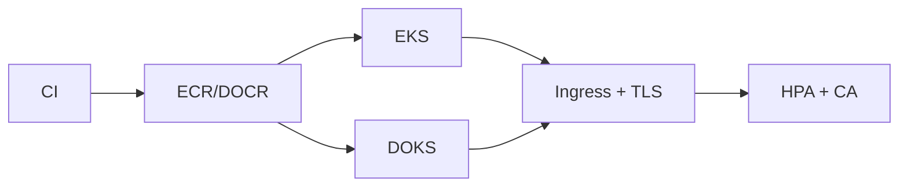

# 03. Multi-Cloud Kubernetes Platform


**AWS EKS · DigitalOcean DOKS · Helm** · *Phase 2 — Intermediate delivery* · `lab`.

> EKS + DOKS with Helm, ingress, autoscaling (HPA/CA), workload security. Same chart deploys to both clouds.

## Contents

1. Outcomes 2. Architecture 3. Prerequisites 4. Repo map 5. Step 0 clone 6. Step 1 local kind lab 7. Step 2 Helm deploy 8. Step 3 autoscaling + ingress 9. Step 4 EKS/DOKS real provisioning 10. Step 5 workload security 11. CI/CD 12. Cost/teardown 13. Troubleshooting

## 1. Outcomes

- One Helm chart `app/chart` runs on kind (laptop), EKS and DOKS unchanged.
- Ingress + TLS pattern, HPA + Cluster Autoscaler, resource requests/limits.
- Terraform stubs `terraform/eks.tf`, `terraform/doks.tf` for real clusters.

## 2. Architecture



Request: Internet → LB → ingress-nginx → Service → Deployment (`lab-app:2`) → HPA scales 2–5 on CPU.

## 3. Prerequisites

- docker, `kind` or `k3d`, `kubectl`, `helm` — `brew install kind kubectl helm`.
- AWS: `awscli`, `eksctl` or terraform. DO: `doctl`.
- No cloud needed for Steps 0–3.

## 4. Repository map

```
app/chart/Chart.yaml
app/chart/values.yaml            # replicaCount 2, image lab-app:latest
app/chart/templates/deployment.yaml
monitoring/hpa.yaml              # HPA 2-5
terraform/eks.tf                 # EKS lab stub (fill vars)
terraform/doks.tf                # DOKS stub
```

## Step 0 — Clone and hygiene

```bash
git clone https://github.com/navin-kumar10/multicloud-kubernetes-platform.git
cd multicloud-kubernetes-platform
bash tests/smoke.sh
helm lint app/chart
```

## Step 1 — Local cluster

```bash
kind create cluster --name lab
kubectl cluster-info
kubectl get nodes
```

Alternative: `k3d cluster create lab --servers 1 --agents 1`.

## Step 2 — Deploy chart

```bash
helm upgrade --install lab-app app/chart --set image.tag=latest
kubectl rollout status deploy/lab-app
kubectl get pods,svc,hpa
kubectl port-forward svc/lab-app 8080:80 &
curl -s http://localhost:8080/ | head -c 200; echo
kill %1
```

Chart values: `helm show values app/chart`. Override per env: `helm upgrade --install lab-app app/chart -f app/chart/values-prod.yaml`.

## Step 3 — Autoscaling + ingress

```bash
kubectl apply -f monitoring/hpa.yaml
kubectl get hpa lab-app
# ingress-nginx (lab):
helm upgrade --install ingress-nginx ingress-nginx --repo https://kubernetes.github.io/ingress-nginx --namespace ingress-nginx --create-namespace --set controller.service.type=NodePort
kubectl get svc -n ingress-nginx
# load test HPA:
kubectl run load --image=busybox --restart=Never -- /bin/sh -c "while true; do wget -q -O- http://lab-app; done" &
kubectl get hpa -w
kubectl delete pod load --force 2>/dev/null; true
```

## Step 4 — Real EKS / DOKS (when ready)

EKS:

```bash
export AWS_REGION=us-east-1
# fill terraform/eks.tf module terraform-aws-modules/eks/aws, then:
terraform -chdir=terraform init
terraform -chdir=terraform plan
terraform -chdir=terraform apply
aws eks update-kubeconfig --name lab --region $AWS_REGION
```

DOKS:

```bash
doctl auth init
# fill terraform/doks.tf digitalocean_kubernetes_cluster, then plan/apply
doctl kubernetes cluster kubeconfig save lab
```

Use smallest nodes for lab (1–2 nodes), autoscale min=1, destroy nightly. Images: ECR for EKS, DOCR for DOKS (`doctl registry login`).

## Step 5 — Workload security

- `runAsNonRoot`, read-only FS, drop ALL caps, seccomp, requests/limits set.
- `sealed-secrets` or external-secrets, NetworkPolicy default-deny + allow DNS/ingress.
- Scan image in CI (Project 09 pattern), sign with cosign, admit only signed.

## Step 6 — CI/CD

Extend with Project 04 reusable workflow: lint chart (`helm lint`, `kubeconform`), `terraform plan` on PR, image build/push, staging `helm upgrade`, smoke (`kubectl wait` + curl), approval → prod.

## Step 7 — Cost and teardown

```bash
helm uninstall lab-app || true
kind delete cluster --name lab
# cloud (if provisioned):
terraform -chdir=terraform destroy
# verify: no clusters, LBs, node pools remain
```

Cost drivers: control-plane hours + nodes + LB. Single-node dev, scale-to-zero dev, spot where safe.

## Troubleshooting

| Symptom | Cause | Fix |
|---|---|---|
| `ImagePullBackOff` | tag/registry wrong | `kubectl describe pod`, check `values.yaml` image |
| `pending` pods | no capacity | `kubectl describe`, add nodes / lower requests |
| HPA `<unknown>` | metrics-server missing | `kubectl apply -f https://github.com/kubernetes-sigs/metrics-server/releases/latest/download/components.yaml` |
| ingress 404 | host/path mismatch | `kubectl describe ingress`, check class |

Portfolio: Phase 2 core. Connect Argo CD (04) and observability (02) next. MIT — LICENSE.
