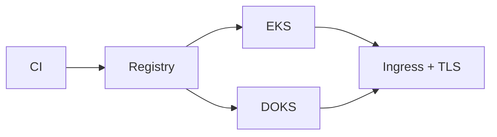

# Architecture - Multi-Cloud Kubernetes Platform

*Phase 2 - Intermediate delivery* | AWS EKS - DigitalOcean DOKS - Helm

## Diagram

See architecture.png (source: files/03_multicloud_kubernetes.png).

## Decisions

1. Reproducibility first - infra as code is source of truth.
2. Env separation: dev < staging < prod, per-env tfvars/state, prod approval.
3. Least privilege IAM/RBAC, OIDC in CI, no checked-in secrets.
4. Defense in depth: validation + authn/z + throttling + TLS + encryption + scans.
5. Observability: structured logs, correlation IDs, RED/USE metrics, runbook-linked alerts.
6. Cost awareness: small lab sizes, retention/lifecycle limits, Budgets alerts.
7. Lab labeling: sample apps are small; verify claims via tests/.

## Troubleshooting

- plan auth error: check profile/region, sts get-caller-identity.
- state lock: confirm no active apply before force-unlock.
- smoke 4xx/5xx: check env vars/secrets.
- cost surprise: make destroy + verify console (LB/DB/cluster/bucket/zone/WAF).
